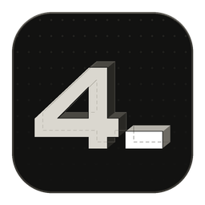

<p align="center">
  
</p>

<h1 align="center">4Terminal</h1>

<p align="center">
  <b>The Windows terminal built for AI coding agents.</b><br>
  Native, GPU-rendered, free for personal use — by <a href="https://4dimntion.com">4dimntion</a>.
</p>

---

Run Claude Code, Codex CLI and your shells side by side without losing sight of any of them.
4Terminal knows when an agent is working, when it needs you and when it is done.

- **Agents at a glance** — every terminal in one list, with the agent's icon animated while it
  works, amber when it asks you something, green when it finishes. Rename any of them.
- **Three views** — tabs, a floating panel or a sidebar on either side; one button switches.
- **Notifications** — a Windows notification and a badge when an agent needs you and you are
  looking elsewhere. Click it to land on that terminal.
- **Sessions that survive the window** — close 4Terminal and your agents keep running; reopen it
  and every tab, split and its history comes back.
- **One click to start an agent** in the current folder; `4t tab --worktree -- claude` gives it its own git worktree.
- **Fast** — native Win32 + Direct2D with a GPU glyph atlas and a bundled ConPTY.
- **No telemetry.**

## Install

From any PowerShell, per user, no administrator rights:

```powershell
irm https://4dimntion.com/4terminal/install.ps1 | iex
```

It downloads the latest release from this repository, checks its SHA-256, installs it in
`%LOCALAPPDATA%\Programs\4Terminal` and adds `4terminal` and `4t` to your PATH.

```powershell
4t update --check   # is there a newer version?
4t update           # install it
4t hooks            # how to connect Claude Code and Codex
```

Uninstall from *Settings › Apps*. Your settings in `%APPDATA%\4Terminal` are kept.

Requires Windows 10 or 11, x64.

## License

4Terminal is **free for personal use**. Companies and other organizations need a commercial
license: ask at [4dimntion.com/contacto](https://4dimntion.com/contacto). The full license
(EULA) ships with each release.

4Terminal is not open source: this repository holds its releases and its issue tracker, not its
code. It includes open source components, listed with their licenses in
`THIRD-PARTY-NOTICES.txt` inside each release.

## Feedback

Found a bug or missing something? [Open an issue](../../issues/new/choose).

---

<p align="center"><sub>
  Gratis para uso personal · las empresas necesitan licencia ·
  <a href="https://4dimntion.com/soluciones/4terminal">4dimntion.com/soluciones/4terminal</a>
</sub></p>
